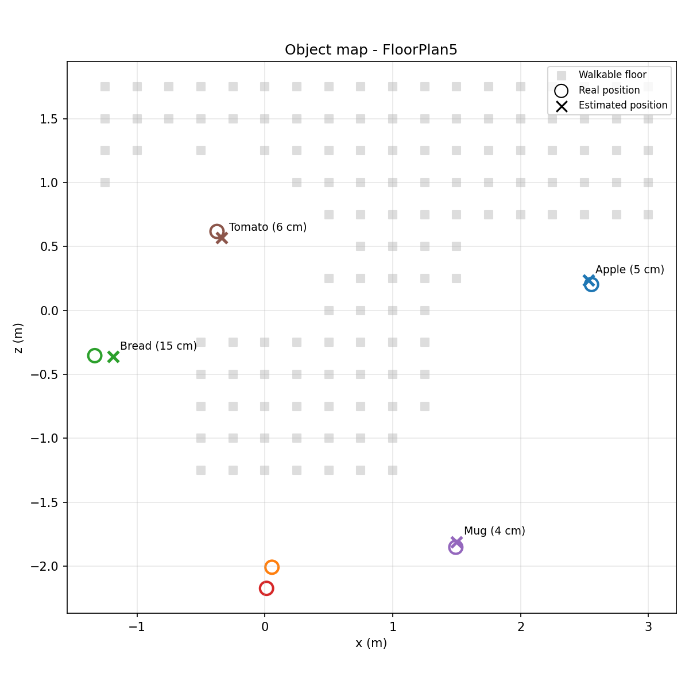

# Object Localization (2D → 3D)

Finds the 3D position of each object detected by YOLO, using the depth image from AI2-THOR.

## How it works
1. YOLO detects objects in the RGB frame.
2. The median depth at the center of each box gives the distance.
3. Using the camera field of view, height, tilt and the robot's heading, the pixel + depth is converted to world coordinates (x, y, z).
4. Detections from many viewpoints are fused: detections of the same class closer than 30 cm are merged, and objects seen only once are rejected as likely false detections.

## Results (FloorPlan5, 30 viewpoints)
| Object | Seen | Error |
|---|---|---|
| Apple | 6 | 5 cm |
| Mug | 2 | 4 cm |
| Tomato | 3 | 6 cm |
| Bread | 3 | 15 cm |

Mean error 7.5 cm, median 5.5 cm. 3 single-sighting detections were rejected.

## Files
- `localizer.py` – `ObjectLocalizer` (detection → 3D) and `ObjectMap` (multi-frame fusion)
- `build_map.py` – explores a scene, builds and evaluates the object map
- `plot_map.py` – draws the top-down map
- `localize.py` – first prototype (single frame)

## Run
python build_map.py
python plot_map.py
