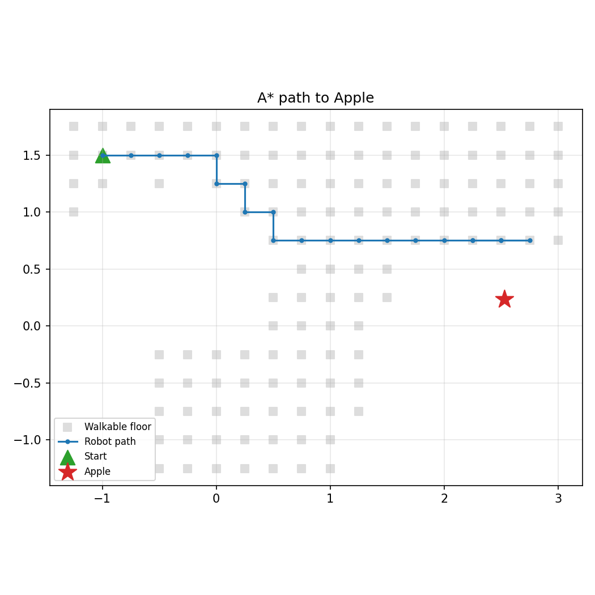

# Navigation & Pickup (A*)

The robot finds a target object, plans the shortest path to it, drives there, and picks it up.
Builds on the object map from [localization](../localization).

## Pipeline
1. **Explore** – the robot looks around from 40 random viewpoints and builds an object map (YOLO + depth, multi-frame fusion).
2. **Choose the target** – the map entry of the requested class with the most sightings.
3. **Grid map** – AI2-THOR reachable positions become a 0.25 m grid. Free cells are walkable; everything else (counters, tables, shelves) is an obstacle.
4. **Approach cells** – free cells within 1 m of the target, sorted from nearest to farthest.
5. **A\*** – shortest 4-connected path from the robot to the approach cell.
6. **Drive** – the path is converted into `RotateLeft` / `RotateRight` / `MoveAhead` actions.
7. **Face the object** – the robot turns and tilts its camera toward the target.
8. **Verify and pick up** – YOLO re-checks the target (lower confidence threshold, since we expect it there), then `PickupObject`.
9. **Recovery** – if the pickup fails (e.g. the object is hidden by a shelf), the robot plans to the next approach cell and tries again (up to 3 attempts).

## Example run (FloorPlan5, target: Apple)
| Step | Result |
|---|---|
| Apple in object map | seen 7x, position error 5 cm |
| Start distance | > 2 m from the target |
| Attempt 1 | 17 steps – pickup failed |
| Attempt 2 | 1 step – pickup failed |
| Attempt 3 | 2 steps – **pickup succeeded** |

## Known limitations
- **Close-range verification:** at the approach cell, YOLO did not re-detect the apple (steep downward angle, object on a low shelf). The pickup used the position from the object map.
- **Scene randomness:** object placement can differ between runs even with the same seed.
- **Obstacles are assumed static.**

## Next steps
- Evaluate the success rate over many runs and different objects.
- Improve close-range verification (look-around scan, better camera angles).

## Files
- `planner.py` – `GridMap`, `astar`, `path_to_actions`
- `fetch.py` – full task: explore → plan → drive → pick up, with recovery
- `output/` – `path.png`, `before_pickup_*.jpg`, `after_pickup.jpg`

## Run
cd navigation
python fetch.py
