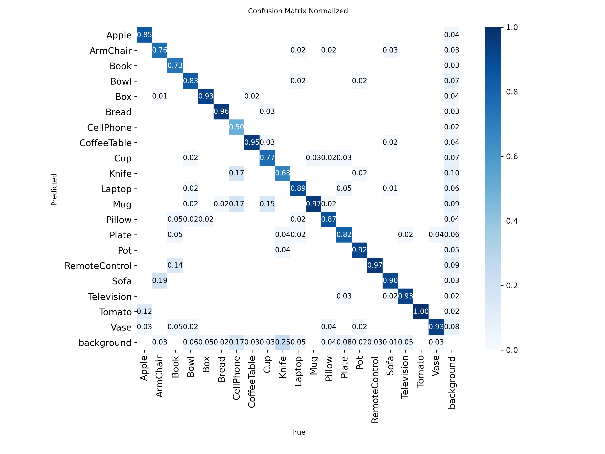

# RoboBrain – Object Detection with YOLOv8 in AI2-THOR

Detecting kitchen objects in the AI2-THOR simulator using YOLOv8, with the dataset managed on Roboflow.

## Classes
Apple, Bowl, Bread, Knife, Mug, Tomato

## Pipeline
1. **Data collection** (`collect_data.py`): the agent is teleported to random positions in 30 AI2-THOR kitchen scenes (FloorPlan1–30) with randomized object placement. Bounding boxes are generated automatically from the simulator's instance detections and saved in YOLO format (598 images).
2. **Dataset management (Roboflow)**: uploaded, reviewed, split 70/20/10, and augmented (horizontal flip, ±20% brightness) → 1435 images.
3. **Training**: YOLOv8n, 50 epochs, 640 image size, on Google Colab (T4 GPU).
4. **Testing** (`test_yolo.py`): the trained model runs on live frames from AI2-THOR.

## Results (validation set)
| Metric | Value |
|---|---|
| mAP50 | 0.80 |
| mAP50-95 | 0.64 |
| Precision | 0.84 |
| Recall | 0.72 |

Per-class mAP50-95: Bread 0.78, Tomato 0.73, Bowl 0.72, Apple 0.71, Mug 0.64, Knife 0.23.
Knife is the weakest class (thin, small objects, fewer examples) — next step is collecting more knife images.

Training plots are in `results/`, and sample detections in `yolo_test/`.

## Files
- `collect_data.py` – dataset generation from AI2-THOR
- `test_thor.py` – AI2-THOR setup check
- `test_yolo.py` – run the trained model in the simulator
- `models/best.pt` – trained weights
- `results/` – training curves, confusion matrix
- `yolo_test/` – detection samples

## Setup
Ubuntu (VMware), Python 3.10 (conda):
pip install -r requirements.txt

## v2: 20 classes (kitchens + living rooms)

One YOLOv8n model for kitchens and living rooms. Weights: `models/best_v2.pt`.

**Classes**
- Kitchen: Apple, Mug, Bowl, Bread, Tomato, Knife, Plate, Cup, Pot
- Living room: RemoteControl, Book, Laptop, Pillow, Vase, Box, CellPhone
- Furniture: Sofa, ArmChair, CoffeeTable, Television

**Data**
- `collect_data_v2.py`: 30 kitchens + 30 living rooms, 20 images each (1200 images)
- `collect_boost.py`: targeted close views of rare small classes (CellPhone, Book, RemoteControl, Knife), +130 images
- Roboflow project RoboBrain-v2: 1330 images, split 70/20/10, horizontal flip + brightness ±20% → 3182 images

**Results (validation set)**

| Metric | v1 (6 classes) | v2 (20 classes) |
|---|---|---|
| mAP50 | 0.80 | 0.82 |
| mAP50-95 | 0.64 | 0.67 |
| Precision | 0.84 | 0.89 |
| Recall | 0.72 | 0.74 |

Per-class mAP50-95: Sofa 0.87, CoffeeTable 0.86, Bread 0.84, Television 0.80, Box 0.78, ArmChair 0.77, Apple 0.76, Vase 0.75, Pillow 0.72, Pot 0.70, Tomato 0.70, Plate 0.66, Laptop 0.65, RemoteControl 0.63, Bowl 0.59, Book 0.59, Cup 0.54, Mug 0.50, CellPhone 0.46, Knife 0.30.

**Main confusions:** ArmChair→Sofa 19%, CellPhone→Knife/Mug 17%, Cup→Mug 15%, Book→RemoteControl 14%, Apple→Tomato 12%. Most missed: Knife 25%, CellPhone 17%. Errors happen between similar-looking objects; small thin objects are the weakest.

